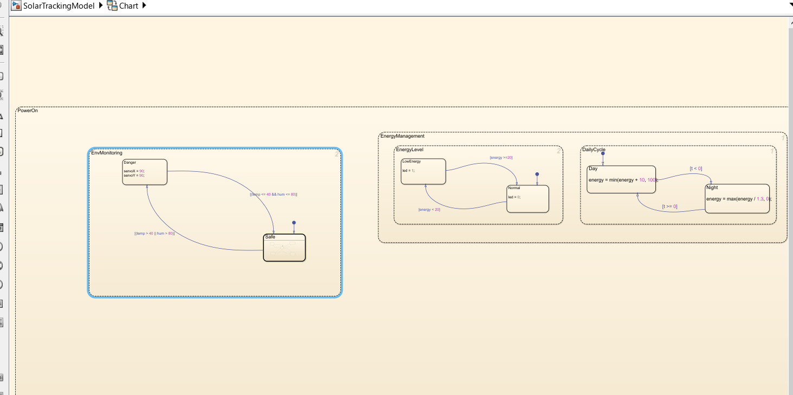
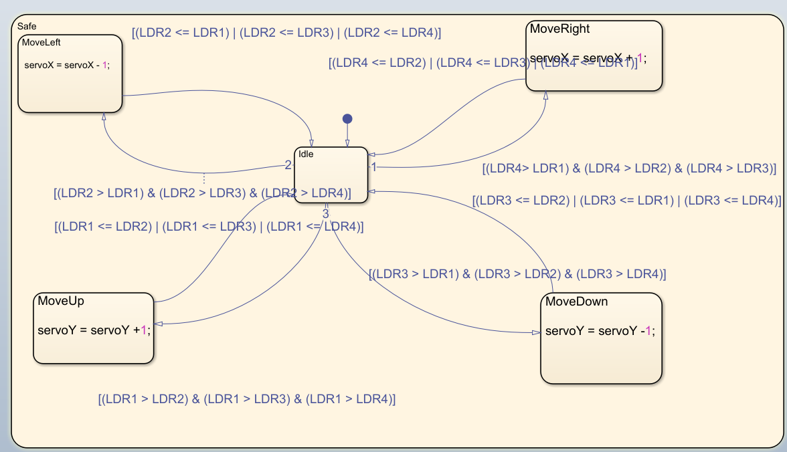
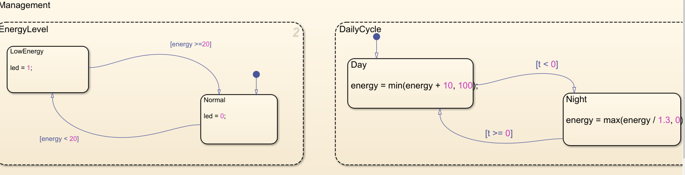
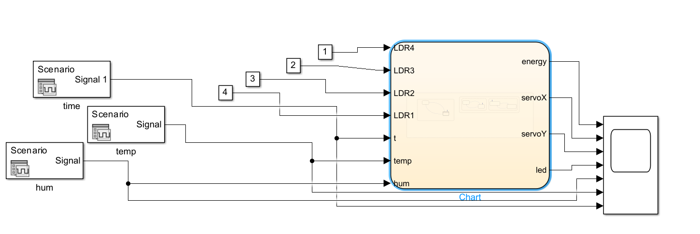
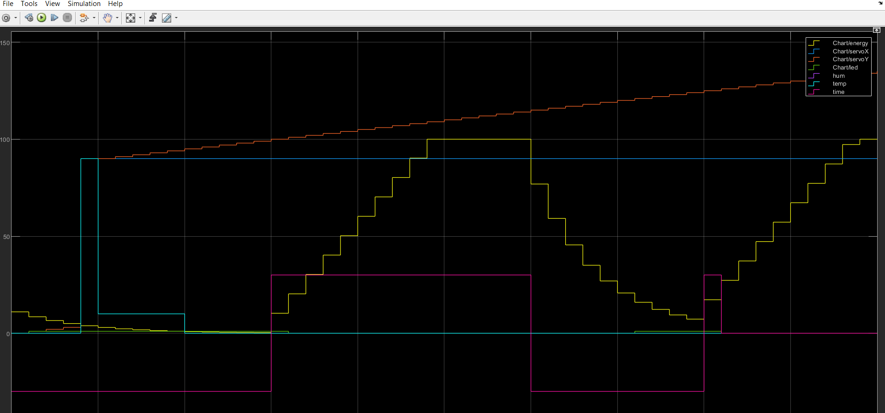
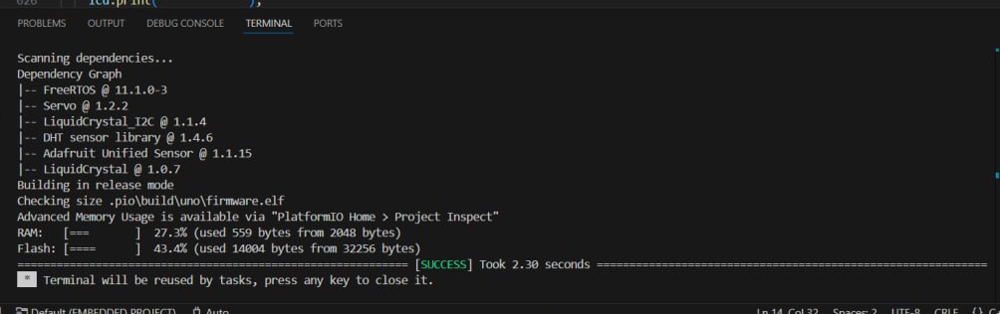
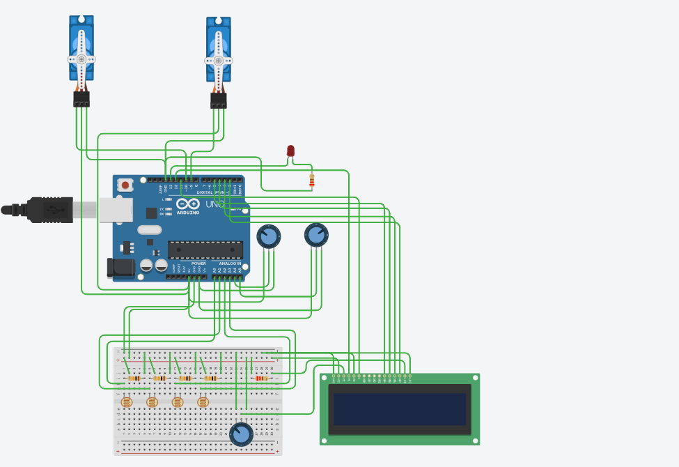
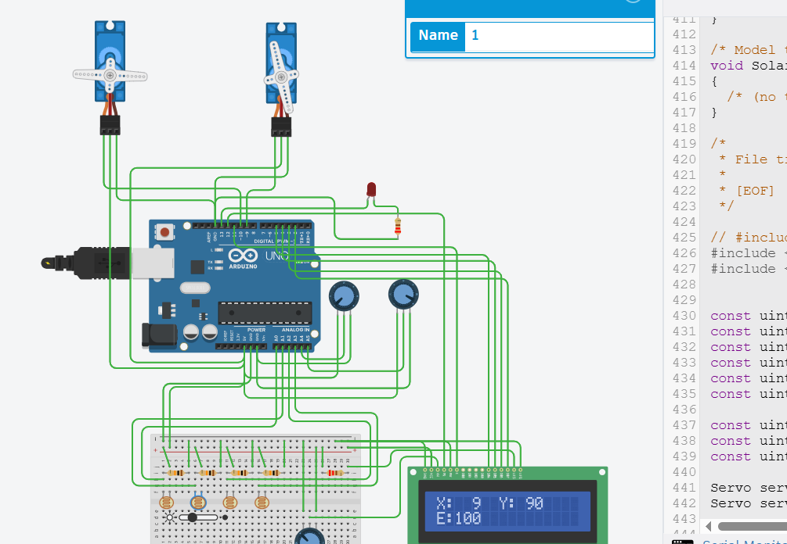
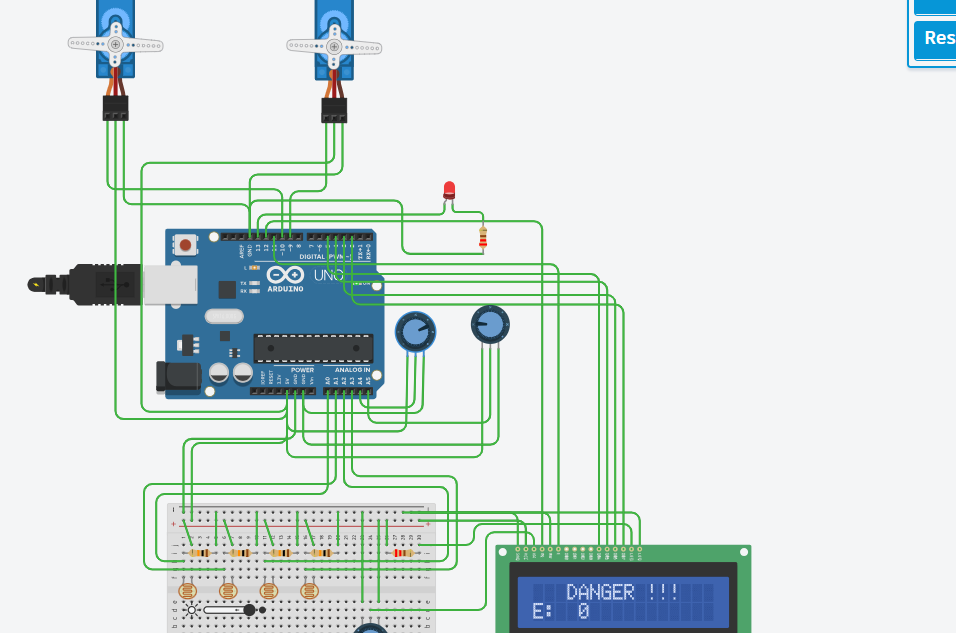

# Solar Tracking Embedded System

A model-based embedded systems course project for a **dual-axis solar tracking system**, combining **Simulink/Stateflow**, **PlatformIO**, **FreeRTOS**, and **Tinkercad**.

The system uses four light-sensor inputs to determine the direction of stronger illumination and adjusts two servo angles accordingly. It also models a day/night energy cycle, monitors environmental conditions, provides a low-energy LED warning, and displays system status on an LCD.

## System Design

The control behavior was first modeled in Simulink and Stateflow. The model is organized around three main concerns:

- **Solar tracking:** compares four LDR inputs and updates horizontal and vertical servo angles.
- **Environmental monitoring:** switches to a danger state when temperature exceeds `40` or humidity exceeds `80`; in this state both servo angles are set to `90°`.
- **Energy management:** models energy variation according to the day/night input and marks energy below `20` as low energy.

The solar-tracking logic treats the four sensors as directional inputs. The sensor with the strongest reading determines the direction in which the panel should move.

The energy and daily-cycle logic are modeled separately in Stateflow.

## Simulink Model

The Simulink model connects the sensor/test inputs to the Stateflow controller and exposes the resulting energy and servo outputs for simulation and analysis.

Example simulation results show the modeled energy behavior, state changes, and servo response to the supplied inputs.

The original model and its input data are available in [`model/`](model/).

## Real-Time Firmware

The PlatformIO implementation targets an **Arduino Uno** and integrates the generated Stateflow logic with FreeRTOS task scheduling.

Three tasks are used:

| Task | Priority | Period / Delay | Responsibility |
| --- | ---: | ---: | --- |
| `TaskSunTrack` | 3 | 50 ms | Reads inputs, steps the control model, updates both servos, and publishes shared state |
| `TaskEnergy` | 2 | 200 ms | Monitors modeled energy and controls the warning LED |
| `TaskLCD` | 1 | 120 ms | Displays servo angles, energy, or the danger warning |

Shared values such as servo angles, energy, and safety state are protected with FreeRTOS critical sections when passed between tasks.

The firmware reads four LDR channels (`A0`–`A3`), a time/day-night control input (`A4`), and an analog environmental input (`A5`). Servo outputs use pins `9` and `10`, while the warning LED uses pin `13`.

The PlatformIO project is available in [`firmware/`](firmware/).

## Tinkercad Simulation

The circuit was also simulated in Tinkercad using an Arduino Uno, four light sensors, two servo motors, an LCD, an LED, and adjustable analog inputs used to exercise the model behavior.

The simulation demonstrates the main operating cases, including directional tracking, low-energy indication, and the environmental danger state.

| Tracking response | Danger state |
| --- | --- |
|  |  |

The source used for the circuit simulation is available in [`simulation/tinkercad-code.c`](simulation/tinkercad-code.c).

## Technologies

- Arduino Uno
- C / C++
- PlatformIO
- FreeRTOS
- MATLAB Simulink
- Stateflow
- Simulink Coder / Embedded Coder workflow
- Tinkercad Circuits

